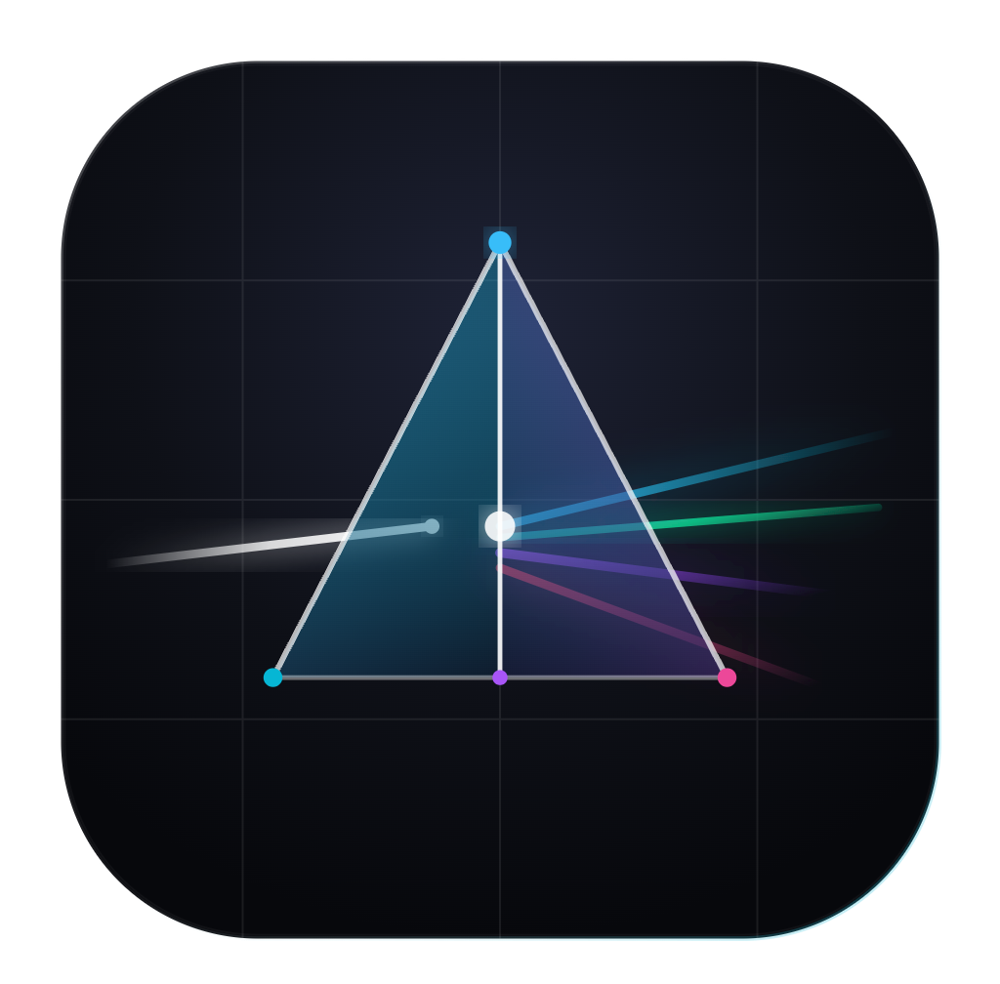

<p align="center">
  
</p>

<h1 align="center">Prism</h1>

<p align="center">
  <strong>One launcher for every AI app and account you run — Cursor, Claude Code, Claude Desktop and Grok Bot.</strong><br />
  Isolated profiles — own login, settings and history — running side by side, with live stats,<br />
  instant switching, fresh or overflow accounts, and color-coded windows so you never mix up Work and Personal again.
</p>

<p align="center">
  <a href="https://github.com/moderniselife/prism/actions/workflows/pr.yml"></a>
  
  
  
  
</p>

<p align="center">
  <a href="#supported-apps">Apps</a> ·
  <a href="#features">Features</a> ·
  <a href="#second-brain-brainium">Second brain</a> ·
  <a href="#quick-start">Quick start</a> ·
  <a href="#terminal-tui">Terminal</a> ·
  <a href="#how-it-works">How it works</a> ·
  <a href="#layout">Layout</a> ·
  <a href="#releasing">Releasing</a> ·
  <a href="#faq">FAQ</a>
</p>

---

A Mojo Layers project. **Three native apps plus a terminal client, one profile format:**

| Platform | Stack | Location | Launch |
|----------|-------|----------|--------|
| macOS | SwiftUI | `Sources/` + `build.sh` | `./build.sh && open "build/Prism.app"` |
| Windows | WPF / .NET 8 | [`windows/`](windows/) | `dotnet build windows/CursorProfiles.csproj -c Release` |
| Linux | GTK4 + libadwaita (Python) | [`linux/`](linux/) | `python3 linux/prism.py` |
| Terminal | Go + Bubble Tea | [`tui/`](tui/) | `go run ./tui` (or `prism-tui`) |

All of them read and write the same profile folders and `.profiles.json` metadata, so profiles roam across operating systems. Every number the UI shows is **measured live** — resident memory from `ps`, window counts from the on-screen window list, CPU from the kernel. Nothing is hardcoded.

## Supported apps

Every profile uses the app's *own* isolation switch, so separation is enforced by the app itself rather than by anything Prism fakes. Your existing install always appears as a protected built-in profile that launches exactly like opening the app normally.

| App | Each profile is | Built-in profile | Profiles folder | Prism apps |
|-----|-----------------|------------------|-----------------|------------|
| **Cursor** | its own `--user-data-dir` (+ `--max-memory`) | Main Cursor | `~/.cursor_profiles` | macOS, Windows, Linux, terminal |
| **Claude Code** | its own `CLAUDE_CONFIG_DIR`, opened in a terminal | Main Claude Code (`~/.claude`) | `~/.claude_code_profiles` | macOS, Windows, Linux, terminal |
| **Claude Desktop** | its own `--user-data-dir` | Main Claude Desktop | `~/.claude_desktop_profiles` | macOS, Windows, Linux, terminal |
| **Grok Bot** | its own `SAND_USER_DATA_DIR` | Main Grok Bot | `~/.grokbot_profiles` | macOS, Linux, terminal |

Each profile has its own sign-in, so you can run several accounts of the same app at once — Work and Personal, or a second account for when the first hits its usage limit.

## Features

### Profiles, properly isolated
- **Profile grid** — colorful cards with per-profile accent color and initial, an app badge, disk size, and last-launched info; filter by app (Cursor / Code / Desktop / Grok)
- **Your original installs are protected** — each app's existing data shows up as a pinned built-in card (**Main Cursor**, **Main Claude Code**, **Main Claude Desktop**, **Main Grok Bot**) with a `BUILT-IN` badge. It launches exactly like opening the app normally, can be cloned or copied into a new profile, and can never be deleted
- **Create / edit / duplicate / rename** with per-profile launch defaults (memory limit for Cursor, default project folder for Cursor and Claude Code)
- Each profile has its own data folder: own login, settings, history. Folders you create by hand are picked up automatically

### Fresh or overflow accounts (every app)
New profiles start as a **fresh account** (empty) or a copy of another same-app profile's config with none of its identity, so you sign in with your other account on first launch. For Cursor, Claude Code and Claude Desktop that copy is an **overflow account**: your working setup comes with you and you carry on where the first account left off. Pick it in the New Profile sheet, or right-click a card → **New Overflow Account from This**. What carries over:
- **Cursor** — `settings.json`, keybindings, tasks and snippets (extensions are already shared). Not the login database or machine id
- **Claude Code** — `settings.json`, `CLAUDE.md`, agents, commands, skills, output styles, hooks and plugins, plus user-level MCP servers and a few preferences from `.claude.json`. Not credentials, account ids or chat history
- **Claude Desktop** — the MCP config and installed extensions with their settings. Not cookies or the login
- **Grok Bot** — called **Copy settings**, not overflow, because it can't bring your agents: they live on your Grok Bot account, not on disk. It copies local settings, permission choices and tool approvals. To bring an agent across, open it in the source profile → **Create Template** → **Share a template link** → **Copy the share link**, then paste the link into a chat in the new profile (paste rather than click, so it opens in that profile). Right-click a Grok Bot card → **New Profile with These Settings**

Copies use allowlists wherever an app mixes config and identity, so an unknown new token file never leaks into an overflow profile. **Duplicate** still makes a full clone (same login) for Cursor and Claude Code. Available in the macOS, Linux and terminal apps; the Windows app doesn't have it yet.

### Second brain (Brainium)
Accounts come and go; your agents' knowledge shouldn't. Prism wires **[Brainium](https://github.com/moderniselife/brainium)** into every profile — a git-backed **personal brain** that follows you (preferences, cross-project learnings, **agent cards** to recreate any agent on a new account) plus each repo's **project brain** — so a fresh or overflow account starts with everything the last one knew.

- **Claude Code** — skill, `CLAUDE.md` section and MCP server; optional **session capture** (redacted, private, outside git) queued to be filed into the brain
- **Claude Desktop** and **Cursor** — the Brainium MCP server (search, read, log, agent cards)
- **Grok Bot** — its agents run in the cloud, so Prism copies an instructions snippet that points them at your personal brain's GitHub repo
- **Summarizing captures** — your own AI does it over MCP by default (no extra tokens), or pick **Anthropic**, **OpenAI**, **Bonsai**, any OpenAI-compatible API, or no AI at all
- Set it up in **Settings → Second brain**: point at a Brainium checkout, create the personal brain, then **Wire All Profiles** (or wire new profiles automatically). Terminal: `W`. Available in the macOS, Linux and terminal apps

### Launching & switching
- **One-click launch** — double-click a card, or open the options popover for per-launch overrides (memory, project folder, force a new window)
- **Drag & drop** — drop any folder onto a card to open it with that profile
- **Global Quick Switch** — press **⌥Space from any app** for the Spotlight-style palette; `⌘K` focuses search, `⌘N` creates a profile
- **Menu bar dropdown** — live per-profile stats, Focus/Start, **Stop All**, and one-click hub access without opening the main window
- **Restart & Update** — Cursor, Claude Desktop and Grok Bot only install a downloaded update once *every* instance has quit, so open profiles block it. Prism spots the waiting update, and one click quits those profiles, lets the installer run, and reopens the same profiles afterwards
- **Independent instances** — profiles start through Launch Services like a Dock launch, so they never depend on Prism: quitting one doesn't affect Prism, and quitting Prism doesn't affect them

### Honest live telemetry
- **Live resident memory** per running profile (summed RSS), against its `--max-memory` limit for Cursor, plus real total RAM for your Mac
- **Real on-screen window counts** per profile — counted, never guessed
- **Real system CPU %** in the status bar
- **Running detection** with graceful quit (SIGTERM)

### Tell profiles apart at a glance
- **Distinct title bar color per Cursor profile** — merged into each profile's `User/settings.json` (`workbench.colorCustomizations` + `window.titleBarStyle: "custom"`), visible in the window, Cmd+Tab, and Mission Control. Your own settings are preserved; only the title bar keys are touched
- **Pin, search, sort** (name / recently used / size)
- **Safe delete** — profiles go to the Trash, never `rm -rf`
- **App auto-detection** for Cursor, Claude Code, Claude Desktop and Grok Bot via Launch Services + well-known paths, with a custom-path override per app in Settings
- **Light & dark mode** that follow the system

## Quick start

**macOS** — requires macOS 14+ and the Xcode Command Line Tools (no full Xcode):

```bash
./build.sh
open "build/Prism.app"
```

The build compiles the Swift sources, generates `Prism.icns` from [`assets/logo.png`](assets/logo.png), assembles and ad-hoc signs the bundle. Optionally move it to `/Applications`:

```bash
cp -R "build/Prism.app" /Applications/
```

**Windows** — requires the [.NET 8 SDK](https://dotnet.microsoft.com/download):

```powershell
dotnet build windows/CursorProfiles.csproj -c Release
```

See [`windows/README.md`](windows/README.md) — including how to pin per-profile taskbar shortcuts with their own icons.

**Linux** — requires GTK 4.10+, libadwaita 1.2+, and PyGObject (see [`linux/README.md`](linux/README.md) for distro packages):

```bash
python3 linux/prism.py
```

Every pull request to `main` rebuilds all three platforms automatically — see [`.github/workflows/pr.yml`](.github/workflows/pr.yml).

## Terminal (TUI)

`prism-tui` is Prism for the terminal — same profiles, no app. List, filter,
launch, stop, create and delete profiles with live RSS and system stats.
See [`tui/README.md`](tui/README.md) for keys.

```bash
npm i -g prism-tui            # Node users
pipx install prism-tui        # Python users
brew install --cask moderniselife/prism/prism-tui
winget install ModerniseLife.PrismTUI
```

> **Package registries go live with the first `v*` release** — until
> then, run it from source (below). Binaries are already on the way.

Or grab a static binary from
[GitHub releases](https://github.com/moderniselife/prism/releases) — no
runtime needed anywhere. From source: `go run ./tui` (Go 1.23+).

> First run opens unsigned on macOS Gatekeeper the same way as the `.app`
> below: right-click → Open once. The Homebrew cask clears quarantine
> automatically.

## How it works

```
~/.cursor_profiles/          # Cursor editor profiles
  .profiles.json        # names, colors, launch defaults (shared across OSes)
  Work/                 # a full Cursor user-data-dir
  Personal/             # another one — fully independent
~/.claude_code_profiles/     # Claude Code profiles (each dir = a CLAUDE_CONFIG_DIR)
~/.claude_desktop_profiles/  # Claude Desktop profiles (--user-data-dir)
~/.grokbot_profiles/         # Grok Bot profiles (SAND_USER_DATA_DIR; agents in <profile>/sand-data)
```

Launching a Cursor profile runs Cursor with `--user-data-dir <profile> --max-memory <limit>`, so isolation is enforced by Cursor itself rather than by anything Prism fakes. The built-in profile launches with no `--user-data-dir` at all — byte-for-byte identical to opening Cursor normally. Claude Code profiles set `CLAUDE_CONFIG_DIR` (the documented multi-account switch — separate login, settings, history per profile). Claude Desktop profiles launch with `--user-data-dir=<profile>` too, so each has its own login and several run side by side. On Windows this needs the standalone installer build of Claude Desktop (the Microsoft Store build drops launch flags) — Prism prompts you with the download link. Verified on Windows; macOS and Linux are untested.

Grok Bot profiles launch with `SAND_USER_DATA_DIR=<profile>` — the app's own isolation switch, which moves both its Electron data and its agent data root (`~/.grokbot` → `<profile>/sand-data`) and gives each profile its own single-instance lock. Prism adds a matching `--user-data-dir=<profile>` only so it can recognise the profile in the process list (environment variables aren't visible there). The built-in profile launches with neither. Overflow carry-over copies the data root only, skipping identity and runtime files and stripping account-scoped keys from `settings.json`; Electron's userData is never copied because it holds the Keychain-encrypted tokens and machine id. The Mac app, Linux app and terminal client support Grok Bot; the Windows app doesn't yet.

## Layout

```
Sources/CursorProfiles/
  CursorProfilesApp.swift   # App entry, hidden title bar, menu-bar extra, ⌥Space hotkey
  ContentView.swift         # Main hub: title bar, filters, grid, live status bar
  ProfileCard.swift         # Card UI, live memory bar, launch popover, drag & drop
  ProfileEditorSheet.swift  # Create/edit sheet with live preview
  SpotlightCommandBar.swift # ⌥Space quick-switch palette
  SettingsView.swift        # App paths, defaults, storage
  ProfileStore.swift        # Metadata, CRUD, live RSS/CPU/window polling
  SystemStats.swift         # Real CPU/RAM/window measurement + global hotkey helpers
  CursorLauncher.swift      # Find/launch/quit Cursor processes
  ClaudeLauncher.swift      # Find/launch Claude Code (CLAUDE_CONFIG_DIR) & Desktop (--user-data-dir)
  GrokLauncher.swift        # Find/launch/detect Grok Bot (SAND_USER_DATA_DIR)
  CarryOver.swift           # Fresh vs overflow accounts: what each app may copy
  BrainiumBridge.swift      # Second brain: find node + Brainium, run its CLI
  ProfileStore+Brain.swift  # Second brain actions (wire, capture, summarizer)
  SecondBrainSettingsView.swift # Settings → Second brain tab
  TitleBarColorizer.swift   # Merges per-profile title bar colors into User/settings.json
  PrismTheme.swift          # Adaptive light/dark design system
  MeshBackgroundView.swift  # Ambient background
  Models.swift              # Profile model, palette, formatting helpers
assets/
  logo.png                  # Source of truth for the logo + macOS app icon
tui/
  main.go, store.go,        # TUI: entry, profiles/persistence/launch/detect
  stats.go, colorize.go, ui.go
  grokbot.go, carryover.go  # Grok Bot support, overflow carry-over rules (+ tests)
  brainium.go               # Second brain wiring (+ integration test with the real CLI)
npm/prism-tui/              # npm wrapper (downloads the release binary)
pypi/prism-tui/             # PyPI wrapper (platform wheels bundle it)
packaging/homebrew-cask/    # Prism.app cask template for the tap
```

## Releasing

Push a tag like `v1.2.3` and [`.github/workflows/release.yml`](.github/workflows/release.yml)
ships everything: GoReleaser binaries + checksums + the Homebrew TUI cask,
the signed `Prism.app.zip`, five platform wheels on PyPI, the npm package,
a Winget submission PR, and the tap's `Prism.app` cask update.

One-time setup before the first release:

1. Create the empty **`moderniselife/homebrew-prism`** tap repo.
2. Repo secrets: **`TAP_GITHUB_TOKEN`** (classic PAT, `repo` scope),
   **`NPM_TOKEN`** (publish rights), **`PYPI_API_TOKEN`**,
   **`WINGET_TOKEN`** (classic PAT, `public_repo` scope), plus a fork of
   `microsoft/winget-pkgs` under `moderniselife`.
3. **Winget's first version must be submitted by hand** — the automation
   refuses brand-new packages. Run `komac update ModerniseLife.PrismTUI`
   once against a published release, then automation takes over.

## FAQ

<details>
<summary><strong>Why is there no "pin to Dock with a custom icon" feature?</strong></summary>

An earlier build generated a wrapper `.app` per profile with its own icon. It was removed for two reasons:

1. **It didn't work while running.** macOS shows the Dock icon of whatever bundle is *actually running* — since the wrapper just launches Cursor's real binary, open windows always showed Cursor's stock icon.
2. **It multiplied permission prompts.** Each wrapper is a distinct app identity, and macOS ties Microphone/Camera/folder consent to whichever bundle launched Cursor — so every wrapper re-triggered Cursor's entire permission set as a brand-new app.

Title bar coloring replaces it: it only edits a JSON settings file — no new app identity, no signing, no permission implications. (Windows instead offers per-profile taskbar shortcuts, which are just `.lnk` pointers to the same `Cursor.exe`, so they dodge the identity problem.)

</details>

<details>
<summary><strong>Does Prism spy on my code or phone home?</strong></summary>

No. Everything is local: it reads `ps` output, the on-screen window list, and files in its profile folders (`~/.cursor_profiles`, `~/.claude_code_profiles`, `~/.claude_desktop_profiles`, `~/.grokbot_profiles`) and each app's own data. There is no network code, no analytics, no daemon.

</details>

<details>
<summary><strong>CPU shows "—" sometimes?</strong></summary>

System CPU % is computed from kernel deltas, which need two samples — the first poll after launch has nothing to diff against, so it shows a dash until the second one lands (~15s).

</details>
